# VibeScribe

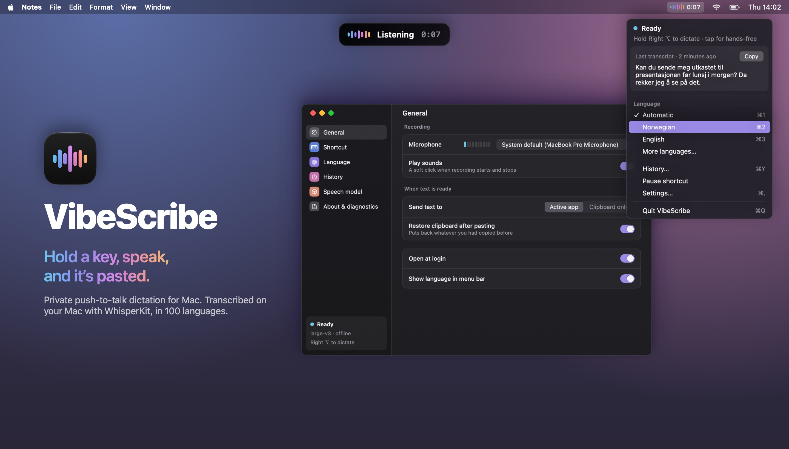

A menu bar app for push-to-talk dictation on Mac. Hold a key, speak, and let go: VibeScribe types what you said wherever your cursor is. Speech is transcribed on your Mac, either by Whisper through [WhisperKit](https://github.com/argmaxinc/argmax-oss-swift) in 100 languages, or by the faster, English-only [Underdog Bark](https://huggingface.co/ConwayResearch/Underdog-Bark-3.0-Plus). No account, API key or cloud service is involved.

## Install

Download [VibeScribe.dmg](https://github.com/flatoy/vibescribe/releases/latest/download/VibeScribe.dmg) from the [latest release](https://github.com/flatoy/vibescribe/releases/latest), open it and drag VibeScribe to your Applications folder. The app isn’t notarized by Apple, so macOS warns that it can’t verify VibeScribe the first time you open it: close the warning, then click **Open Anyway** in System Settings > Privacy & Security. Then continue with step 3 below. Or build it from source:

The app runs on macOS 14 or later on Apple Silicon. Building it requires macOS 15.6 or later, Swift 6.2 or newer, and the macOS 26 SDK. This build was verified with Swift 6.3.3 and Apple Command Line Tools 26. A standalone Swift toolchain also needs the matching [Apple Command Line Tools](https://developer.apple.com/documentation/xcode/installing-the-command-line-tools) for the SDK.

1. Clone and build the app:

   ```bash
   git clone https://github.com/flatoy/vibescribe.git
   cd vibescribe
   bash package_app.sh
   ```

2. Move `VibeScribe.app` to your Applications folder and open it.
3. Follow the setup window. Pick a speech model, then grant three permissions while it downloads:
   - **Microphone**, to hear you
   - **Input Monitoring**, so the shortcut works in every app
   - **Accessibility**, to paste for you. Without it, transcripts are copied and you press ⌘V yourself.

   When System Settings opens, a small card follows it. Drag VibeScribe from the card into the list, or turn its switch on if it’s already there. The card closes once the permission is allowed. macOS applies Input Monitoring only after a restart, so choose **Quit & Reopen** when it asks; setup picks up where you left off.

   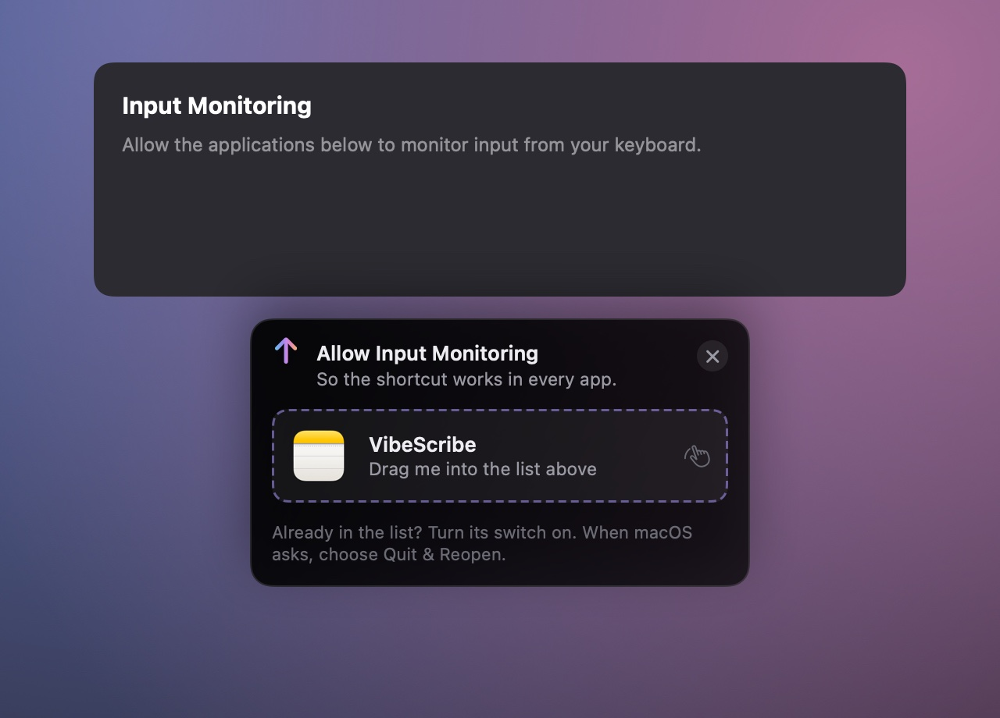

4. Try it in the practice box, then hold **Right ⌥** in any app and speak.

VibeScribe is ad-hoc signed, both the download and your own build. After you update or rebuild, macOS may switch Accessibility off again; the menu bar icon gets an orange dot and the menu offers a one-click fix.

## How it works

### The overlay

A small pill below the menu bar shows what’s happening. The waveform follows your voice while you speak, shimmers while the model works, and confirms how it ended: pasted, copied, or nothing heard. Press **esc** to throw a recording away. Holding the key in silence pastes nothing, instead of the “Thank you.” Whisper tends to invent.

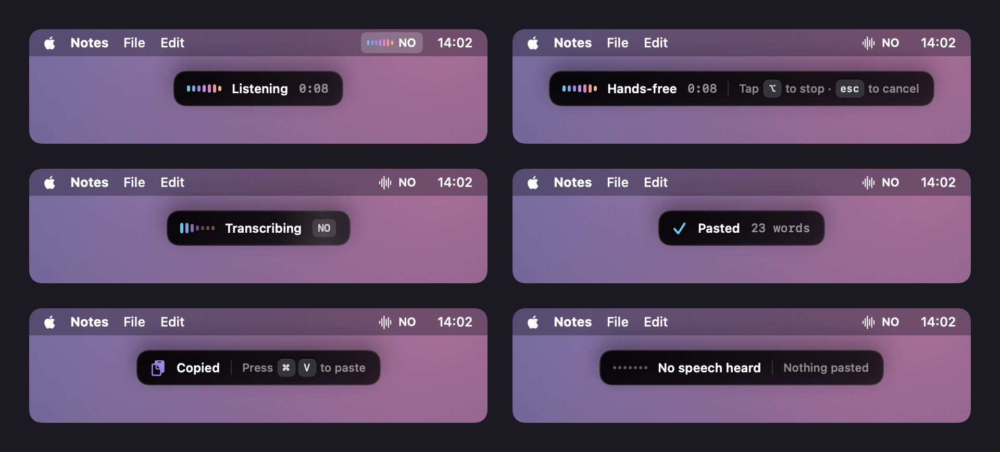

- **Hold** the shortcut to talk, and let go to paste.
- **Tap** it to go hands-free, and tap again to stop.
- Prefer one or the other? Choose **Hold only** or **Tap only** in Settings.

### First launch

The second screen compares the speech models by size, speed, accuracy and languages. The one you pick starts downloading right away and keeps going while you grant permissions, so you rarely wait on a progress bar. You can pause it, and if your connection drops it resumes on its own.

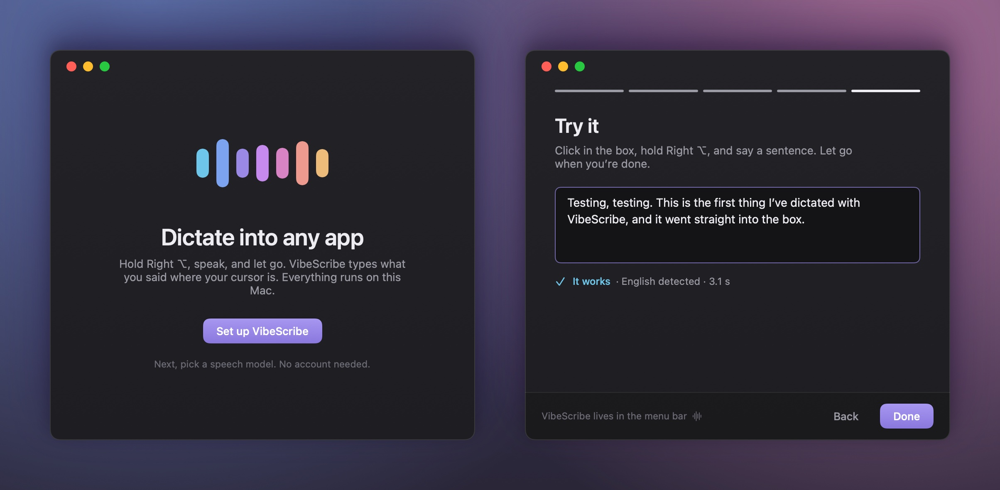

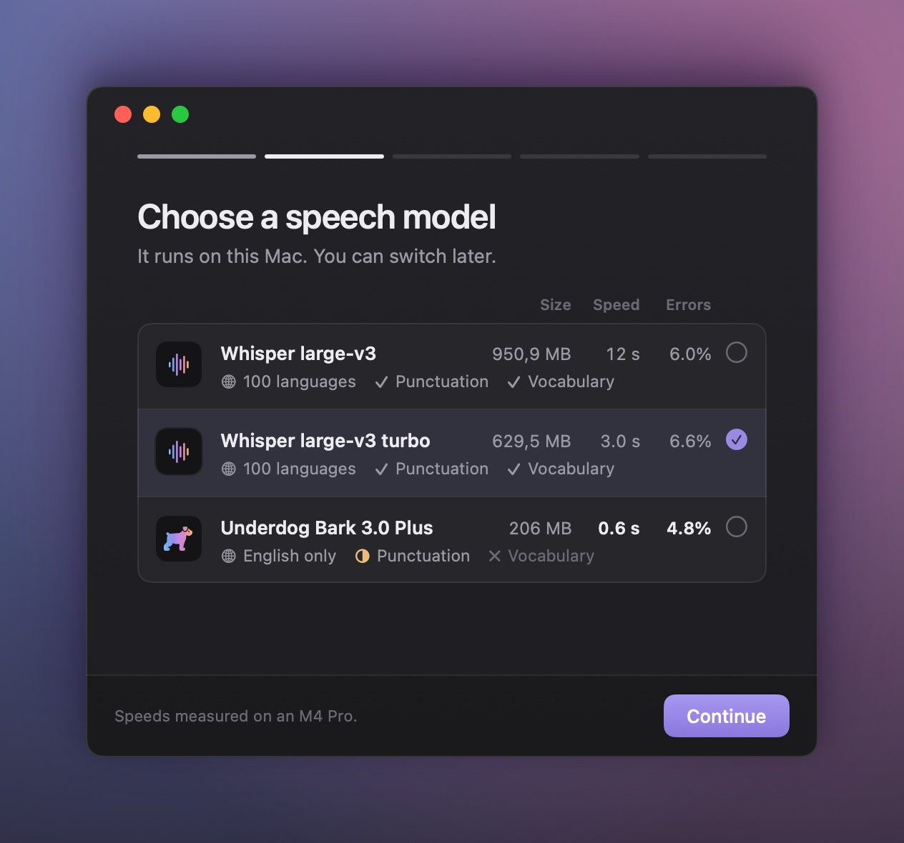

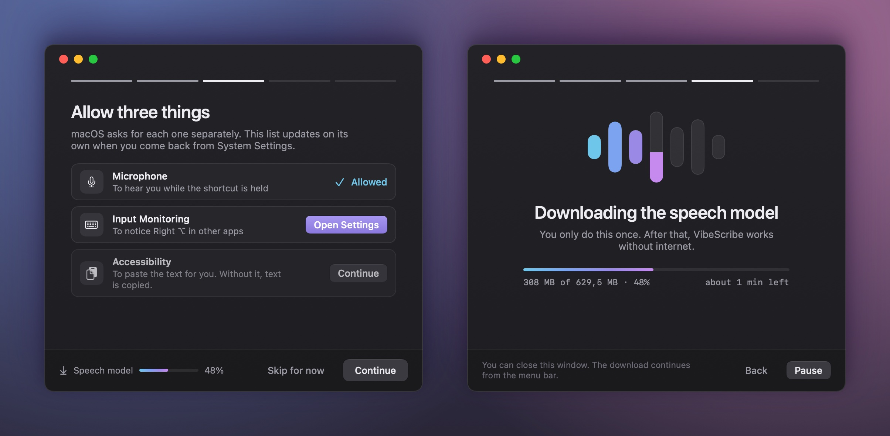

### Languages

Press **⌥⇧** anywhere to search the 100 languages by English or native name. Pin up to three favourites for **⌘1–⌘3**; the languages you used recently sit just below them. **Automatic** detects the language for you. Bark understands only English, so while it’s in use the picker offers to switch to Whisper instead.

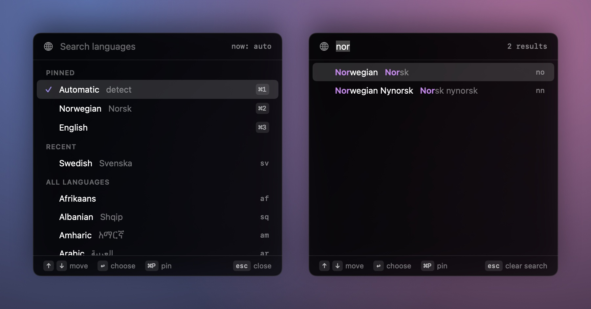

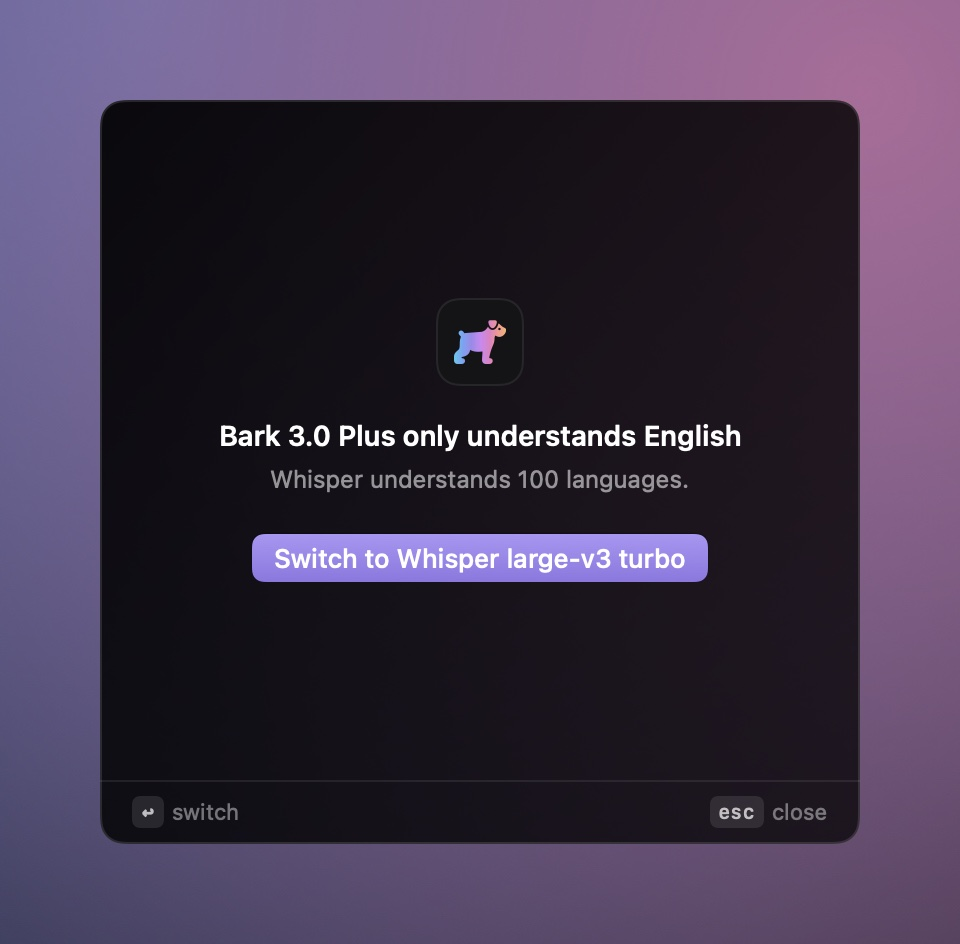

### The menu bar

The icon shows what VibeScribe is doing: ready, recording (the only time it turns colourful), transcribing, downloading, or needing attention. The menu has your last transcript, your pinned languages, and a switch to pause the shortcut during games or screen sharing.

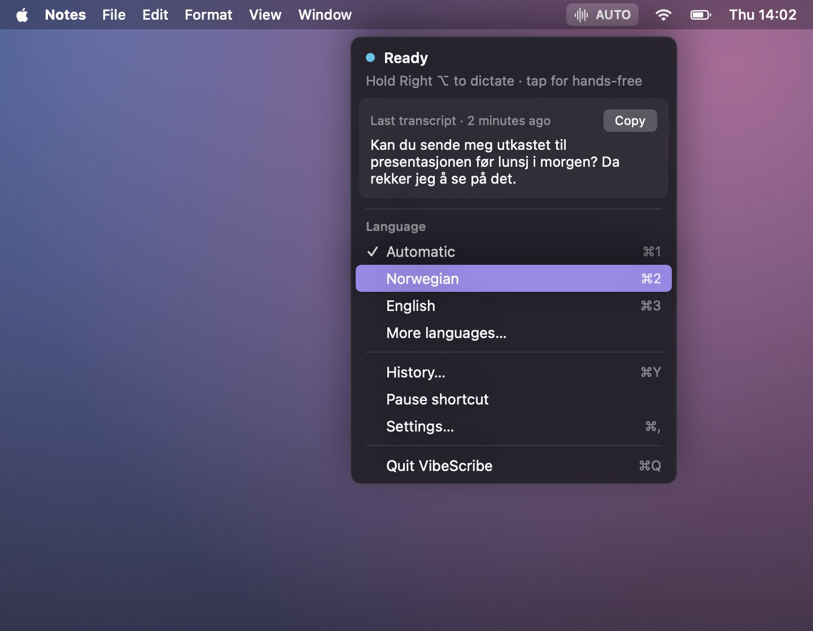

### Settings

Pick a microphone and watch its input level, choose whether text is pasted or only copied, record any shortcut, and add a vocabulary of names and jargon so Whisper spells them your way.

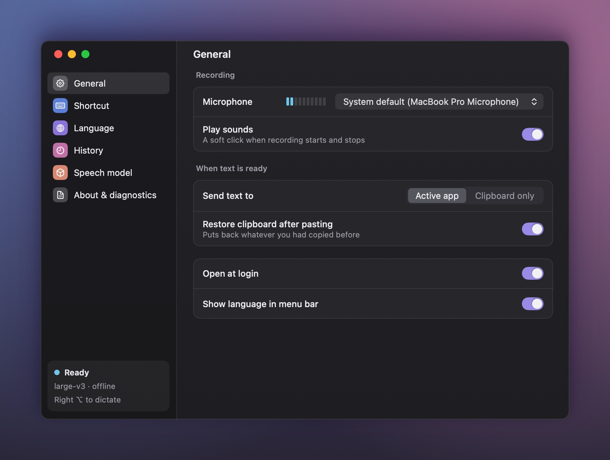

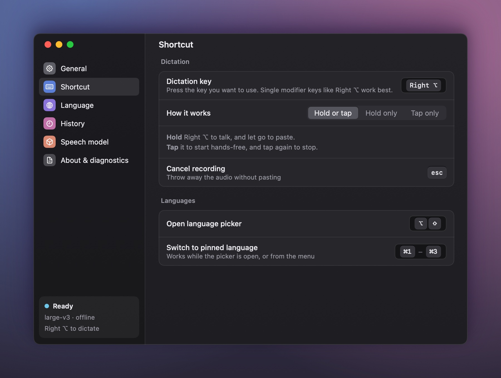

**History** keeps your transcripts on this Mac for as long as you choose, from not at all to forever, so text that went into the wrong window is never lost. Search it, copy an entry, or paste it again.

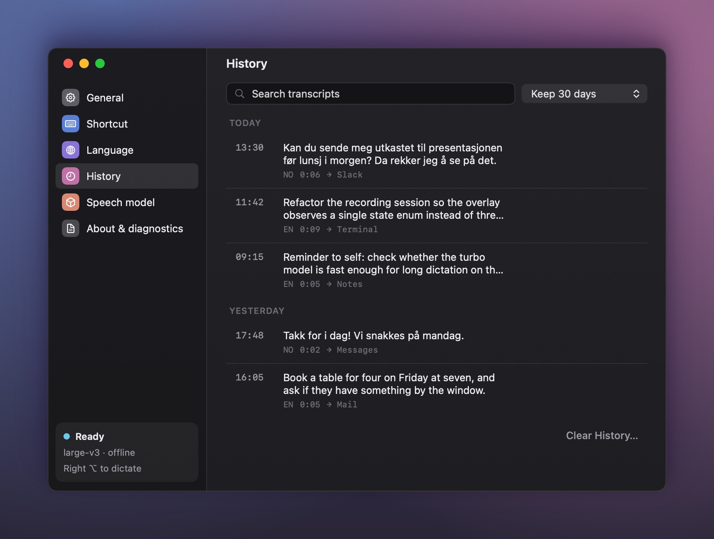

**Speech model** compares the models and shows what’s installed. A new model downloads and loads in the background, and dictation keeps using the current one until it’s ready.

| Model | Download | A minute of speech¹ | Word errors² | Languages |
|---|--:|--:|--:|---|
| Whisper large-v3 | 951 MB | 12 s | 6.0% | 100 |
| Whisper large-v3 turbo | 629 MB | 3.0 s | 6.6% | 100 |
| [Underdog Bark 3.0 Plus](https://huggingface.co/ConwayResearch/Underdog-Bark-3.0-Plus) | 206 MB | 0.6 s | 4.8% | English |

¹ Time to transcribe on an M4 Pro MacBook Pro, the median of three runs after a warm-up.
² Average across the [Open ASR Leaderboard](https://huggingface.co/spaces/hf-audio/open_asr_leaderboard)’s seven English test sets; lower is better. Whisper’s scores are the leaderboard’s for OpenAI’s models, of which the downloads are Argmax’s compressed builds. Bark’s score is Underdog’s, measured with the leaderboard’s code.

Bark needs macOS 15. It understands only English and doesn’t use your vocabulary. It writes short phrases without capitals or punctuation, so VibeScribe gives those a capital and a full stop. Each model’s first load compiles it for your Mac’s chip: under a minute for the Whisper models, about three for Bark.

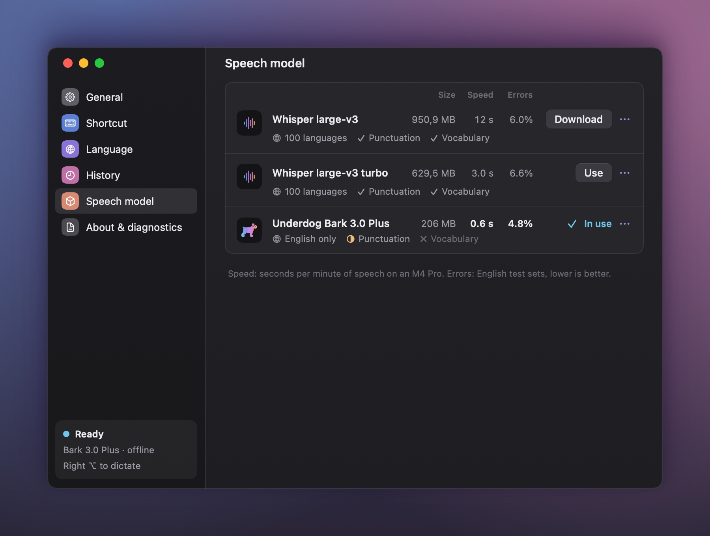

## Privacy

- Audio is processed in memory on your Mac and never saved or sent anywhere.
- The only network traffic is the one-time model download from Hugging Face. Every file is pinned to a revision and verified by SHA-256.
- History is stored in `~/Library/Application Support/io.m10s.vibescribe/History.json` and can be turned off or cleared at any time.

## Develop

Run from source with the same first-launch flow:

```bash
swift run VibeScribe
```

To prefetch a model into the ignored build cache for development or offline smoke tests, run `python3 scripts/download_whisper_model.py`, adding `--model large-v3` or `--model bark-plus` for the others.

Build and run the tests. They use a small executable harness, so Xcode isn’t required:

```bash
swift build
swift run VibeScribeTests
```

Three smoke tests use downloaded models. `--model-smoke <folder> <audio>` transcribes with a Whisper model, `--bark-smoke <folder> <audio>…` with Bark, and `--switch-smoke <turbo folder> <model> <folder> <audio>` checks that dictation keeps working while another model compiles. The speeds above come from a release build:

```bash
swift run -c release -Xswiftc -enable-testing VibeScribeTests --benchmark barkPlus .build/BarkModel-plus minute.wav
```

The README images are rendered from the app’s real SwiftUI views with sample data:

```bash
swift run VibeScribeScreenshots assets
```

### Where things live

| Part | Code |
|---|---|
| App wiring and recording flow | `Sources/VibeScribeCore/VibeScribeApp.swift` |
| Overlay | `Sources/VibeScribeCore/UI/OverlayView.swift` |
| Setup window | `Sources/VibeScribeCore/UI/OnboardingView.swift` |
| Settings window | `Sources/VibeScribeCore/UI/SettingsView.swift`, `SettingsPages.swift` |
| Language picker | `Sources/VibeScribeCore/UI/LanguagePickerView.swift` |
| Speech models and switching | `Sources/VibeScribeCore/SpeechModels.swift`, `WhisperKitClient.swift` |
| Bark (frontend, decoder, `.npz` reader) | `Sources/VibeScribeCore/BarkEngine.swift`, `NumpyArchive.swift` |
| Menu bar | `Sources/VibeScribeCore/MenuBarController.swift` |
| Colours and components | `Sources/VibeScribeCore/UI/Theme.swift`, `Spectrum.swift`, `Controls.swift` |
| Shortcuts and hold/tap logic | `HotkeyListener.swift`, `HotkeyCoordinator.swift` |
| Pinned model downloads | `scripts/whisper_model_manifest.json`, `scripts/whisper_model_manifest_turbo.json`, `scripts/bark_model_manifest_plus.json` |

### Packaging

`package_app.sh` builds a small `VibeScribe.app` without model weights. To customize the bundle ID or version, edit `version.env`. The script supports the `ARCHES`, `SIGNING_MODE` and `APP_IDENTITY` build settings. `scripts/release_github.sh` builds the `dist/VibeScribe.dmg` attached to GitHub releases. It is ad-hoc signed, so other Macs show the first-launch warning described under Install; Developer ID signing and notarization would avoid it.

The editable app icon is `Icon.icon`. After changing it in Icon Composer, export the macOS Default image at 1024 pt and 1× to `Icon.png`; the packaging script converts that image to `Icon.icns`.

## Contributing

Issues and pull requests are welcome. Keep changes focused and run `swift run VibeScribeTests` before submitting.

## License

VibeScribe is MIT licensed; see `LICENSE`. Licenses and notices for WhisperKit and the downloaded speech models are in `Sources/VibeScribe/Resources/Licenses`.
